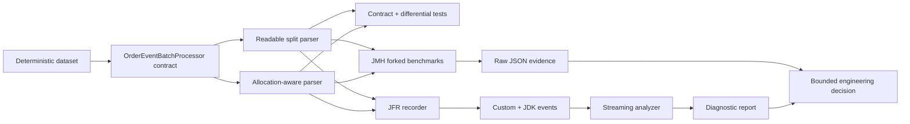

# Java Performance Lab

[](https://github.com/wasiliy-strecker/java-performance-lab/actions/workflows/verify.yml)
[](https://openjdk.org/projects/jdk/21/)
[](https://openjdk.org/projects/code-tools/jmh/)
[](LICENSE)

A correctness-first Java 21 performance case study using JMH, Java Flight
Recorder, allocation profiling, GC analysis, and virtual threads.

This is not a collection of stopwatch snippets. It starts with one behavioral
contract, proves two implementations equivalent, measures them in forked JVMs,
diagnoses runtime effects with JFR, and records the decision with raw evidence.

## Results at a glance

Measured on the [documented reference machine](docs/reference-results.md) with
Temurin 21.0.11, two JVM forks, explicit warm-up, a fixed 2 GiB heap, and the JMH
GC profiler:

| Experiment | Baseline | Candidate | Evidence |
|---|---:|---:|---|
| 10,000 rows, 5% malformed | `String.split`: 765.7 batches/s | Delimiter scan: 1,488.7 batches/s | **1.94x throughput** |
| Allocation for the same batch | `String.split`: 3.44 MB/op | Delimiter scan: 60.6 B/op | **99.998% less allocation** |
| 128 blocking tasks | Platform threads: 8.483 ms/op | Virtual threads: 2.142 ms/op | **74.75% lower batch latency** |
| 128 CPU-bound tasks | Platform threads: 0.624 ms/op | Virtual threads: 0.628 ms/op | **No supported advantage** |

The last row is intentional. The project reports when a technology does *not*
improve the measured workload. Full score errors, GC metrics, raw iterations,
limitations, and reproduction commands are retained in
[reference-results.md](docs/reference-results.md).

## What this demonstrates

- Java 21 API design with records, behavior contracts, overflow-safe
  aggregation, immutable fixtures, and virtual threads
- performance correctness through contract tests plus 30,000 deterministic
  differential rows
- trustworthy JMH setup: parameters, result observability, forks, warm-up,
  allocation metrics, and executable examples of benchmark mistakes
- built-in JFR instrumentation with custom events, streaming analysis, latency
  percentiles, GC counts, and sampled allocations
- engineering judgment: optimization benefits, maintenance costs, privacy,
  uncertainty, and workload limits are documented together
- Maven multi-module builds, a pinned Maven Wrapper, Java 21/25 CI, executable
  shaded JARs, dependency updates, and Apache-2.0 licensing

## Architecture



`performance-workloads` has no dependency on JMH or JFR. Both tooling modules
depend inward on the same workload contract, so instrumentation cannot redefine
business semantics. See [architecture.md](docs/architecture.md) for the measured
boundaries and dependency rules.

## Two-minute review

1. Start with the
   [differential test](performance-workloads/src/test/java/io/github/wasiliystrecker/performance/workload/OrderEventProcessorDifferentialTest.java)
   and the
   [shared contract test](performance-workloads/src/test/java/io/github/wasiliystrecker/performance/workload/OrderEventBatchProcessorContractTest.java).
2. Compare the
   [readable parser](performance-workloads/src/main/java/io/github/wasiliystrecker/performance/workload/ReadableOrderEventBatchProcessor.java)
   with the
   [allocation-aware parser](performance-workloads/src/main/java/io/github/wasiliystrecker/performance/workload/AllocationAwareOrderEventBatchProcessor.java).
3. Inspect the
   [JMH ingestion benchmark](jmh-benchmarks/src/main/java/io/github/wasiliystrecker/performance/benchmark/OrderEventIngestionBenchmark.java)
   and
   [benchmark pitfalls](jmh-benchmarks/src/main/java/io/github/wasiliystrecker/performance/benchmark/BenchmarkPitfalls.java).
4. Review the [measured decision](docs/optimization-decision.md) and the
   [machine-readable results](docs/results/).
5. Follow a custom event from the
   [JFR recorder](jfr-diagnostics/src/main/java/io/github/wasiliystrecker/performance/jfr/DiagnosticRecorder.java)
   into the
   [streaming analyzer](jfr-diagnostics/src/main/java/io/github/wasiliystrecker/performance/jfr/JfrAnalyzer.java).

## Modules

| Module | Responsibility | Main proof |
|---|---|---|
| [`performance-workloads`](performance-workloads/) | Shared parser contract, deterministic fixtures, two implementations | 28 contract and differential tests |
| [`jmh-benchmarks`](jmh-benchmarks/) | Ingestion, executor, and benchmark-pitfall experiments | 8 generated JMH benchmarks |
| [`jfr-diagnostics`](jfr-diagnostics/) | Custom events, recorder, analyzer, CLI | Real-recording integration tests |

## Build and run

Requirements: a full JDK from version 21 through 25. The Maven Wrapper downloads
the pinned Maven distribution.

```bash
./mvnw clean verify
```

The reactor compiles with `--release 21`, treats compiler and Javadoc warnings as
failures where applicable, formats Java with Google Java Format, runs 32 tests,
and packages both executables. CI repeats verification on Java 21 and Java 25.

### JMH

```bash
./mvnw -pl jmh-benchmarks -am package
java -jar jmh-benchmarks/target/benchmarks.jar -l
java -jar jmh-benchmarks/target/benchmarks.jar \
  '.*OrderEventIngestionBenchmark.*' -prof gc
```

CI runs a short forked smoke test but never gates on timing from shared runners.
Use the exact commands in [reference-results.md](docs/reference-results.md) for a
comparable local measurement.

### Java Flight Recorder

```bash
./mvnw -pl jfr-diagnostics -am package
java -jar jfr-diagnostics/target/jfr-diagnostics.jar \
  record allocation-aware target/order-ingestion.jfr
java -jar jfr-diagnostics/target/jfr-diagnostics.jar \
  analyze target/order-ingestion.jfr
```

The analyzer streams events instead of loading a complete recording into memory.
Rejected-row events contain only an index, stable reason, and input length;
customer identifiers and raw input are never recorded. See
[jfr-guide.md](docs/jfr-guide.md) for the event schema and diagnostic workflow.

## Evidence rules

- correctness is established before performance is measured
- fixture creation remains outside measured invocations
- results stay observable to prevent dead-code elimination
- primary scores are interpreted with allocation, GC, and uncertainty data
- raw iterations and environment metadata are versioned with every claim
- local launcher paths are sanitized; `.jfr` files and machine logs are ignored
- a faster candidate is accepted only for the workload its evidence supports

The full process is in
[measurement-methodology.md](docs/measurement-methodology.md).

## Documentation

- [Architecture and measured boundaries](docs/architecture.md)
- [Reference results and reproduction](docs/reference-results.md)
- [Measurement methodology](docs/measurement-methodology.md)
- [Optimization decision record](docs/optimization-decision.md)
- [JFR diagnostic guide](docs/jfr-guide.md)
- [Changelog](CHANGELOG.md)

Contributions should follow [CONTRIBUTING.md](CONTRIBUTING.md). Security and
privacy concerns can be reported through the process in [SECURITY.md](SECURITY.md).

Licensed under the [Apache License 2.0](LICENSE).
