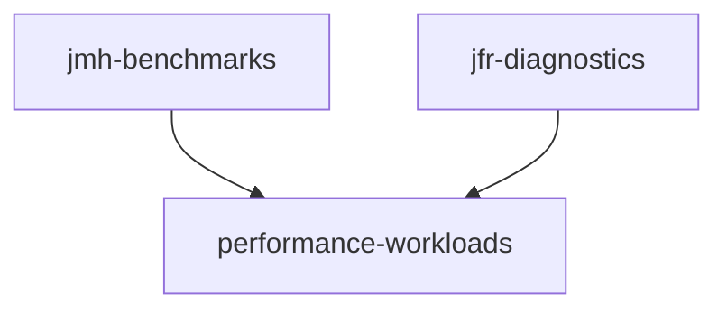
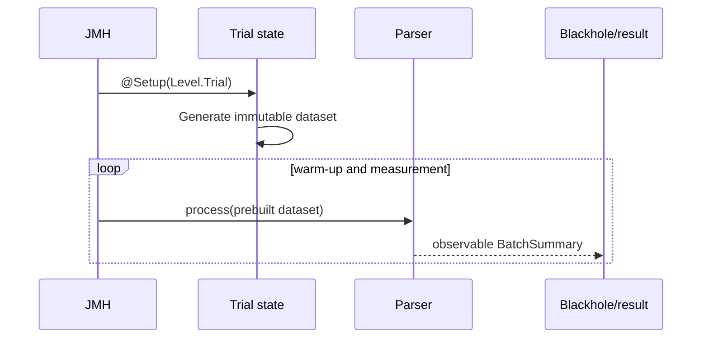
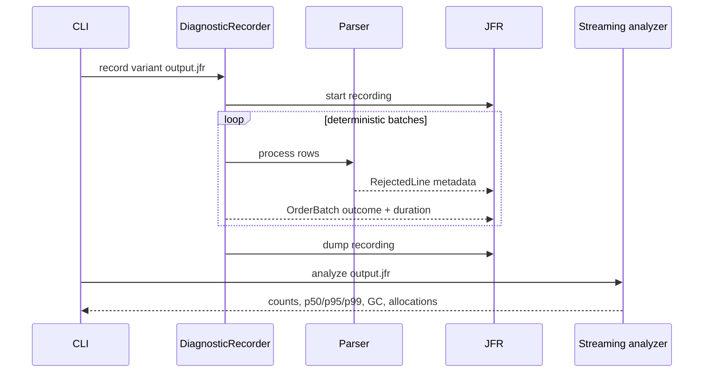

# Architecture

The repository separates domain semantics from performance tooling. Both
measurement paths invoke the same public workload contract and can therefore be
checked against the same expected result.

## Module boundaries



| Module | May depend on | Must not depend on |
|---|---|---|
| `performance-workloads` | JDK 21 | JMH, JFR, test frameworks at runtime |
| `jmh-benchmarks` | Workloads, JMH | JFR diagnostics |
| `jfr-diagnostics` | Workloads, built-in JFR API | JMH |

This keeps the benchmark harness and diagnostic implementation replaceable. It
also prevents benchmark-only shortcuts from leaking into the domain contract.

## Workload contract

Input rows use this synthetic format:

```text
eventId|customerId|currency|amountMinor|status
```

Both processors must:

- accept only positive signed-`long` event IDs
- validate customer identifiers, supported currencies, amounts, and statuses
- aggregate captured minus refunded minor units per currency
- reject a row atomically when parsing or aggregation would overflow
- report stable rejection categories in encounter order
- return the same immutable `BatchSummary`

The readable processor tokenizes with `String.split`. The allocation-aware
processor scans delimiter positions and parses numeric ranges directly. Shared
helpers centralize validation and aggregation semantics; contract tests cover
edge cases, and differential tests compare both implementations over 30,000
deterministic rows.

## JMH measured boundary



Fixture generation and executor construction happen at trial setup. A benchmark
invocation includes the complete processing operation, and the returned checksum
or summary keeps work observable. Fresh forks isolate JIT compilation history.

`BenchmarkPitfalls` contains deliberately invalid controls for constant folding
and dead-code elimination. Their names start with `wrong`, and their scores are
never used as evidence.

## JFR diagnostic flow



The recorder enables two custom events plus the JDK garbage-collection and
sampled-allocation events. The analyzer consumes `RecordingFile` sequentially,
so analysis memory does not grow with the complete event list.

## Privacy boundary

Custom rejection events intentionally expose only:

| Field | Purpose |
|---|---|
| `lineIndex` | Locate a row in the caller's own data |
| `reason` | Stable, content-free failure category |
| `lineLength` | Diagnose malformed structure without content |

Raw rows, customer identifiers, payload fragments, and exception messages are
not event fields. Integration tests inspect the real JFR event schema to protect
this boundary.

## Failure semantics

- invalid input is rejected without mutating batch totals
- arithmetic overflow is classified and rejected rather than wrapped
- handler exceptions propagate and abort the batch, matching the public contract
- invalid CLI usage returns a non-zero status and a concise message
- missing or unreadable recordings fail explicitly
- no benchmark score is used as a correctness or CI threshold
